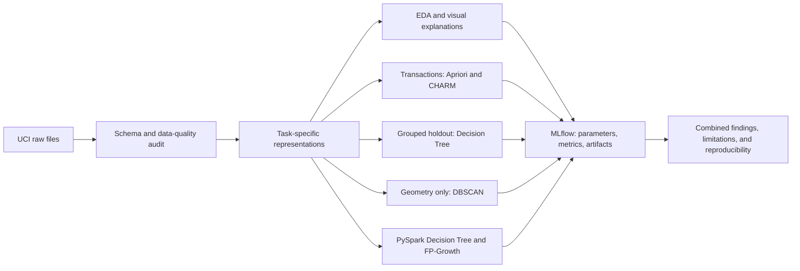

# Report Guide — Internet Advertisements Analytics

**State:** LaTeX drafting may start now. This guide and its figure pack are not the final report. Keep unresolved rubric items visible, use placeholders for the GitHub link until Arpit supplies it, and compile the submission PDF only after the content and artifacts are reconciled.

**Author:** Arpit Kumar Singh  
**Roll number:** CS23I1022  
**Course:** 25CS5004 / CS 5010 — Analytics & Systems of Big Data Practice  
**Dataset:** UCI Internet Advertisements

## 1. What the report should feel like

Tell one clear story in easy English:

> We began with a small, sparse, imbalanced dataset of web-page image examples. We checked what was reliable, chose a different representation for each task, explored the data with plots, then tested association mining, classification, clustering, and Spark. Each method answered a different question. Some results were useful; some assignment requirements could not be answered from this dataset. We state both plainly.

Use short sentences for the main finding. Follow them with enough detail to explain how it was obtained. Define each technical term before using it. Explain why a method fits the question, what it leaves out, and how much confidence the reader should place in the result. Avoid causal language for associations and avoid claiming Spark speedups that were not measured.

The final report should include the 20 primary figures in `figures/` where they improve the story. A feature-importance figure is also supplied as an optional 21st image; include it only after its meaning is checked against the current model output. Avoid repeating a chart merely to make the report longer.

Use one simple pipeline diagram near the start to help new readers see how the parts connect. Redraw this as TikZ in the final LaTeX version:

## 2. Assignment coverage from the handout

The handout asks for preprocessing (cleaning, selection, transformation), at least ten unique course plots with individual inferences, Apriori including a sequential-pattern version, Decision Tree and DBSCAN, CHARM closed itemsets/rules, two PySpark techniques with a performance comparison, commented source code, and a detailed report with conclusions.

Use a small coverage box near the front or in an appendix. Mark completed work separately from limitations:

| Handout item | Evidence to describe | Current status |
|---|---|---|
| Cleaning, selection, transformation | Reproducible quality audit, task-specific imputation and transformations, plus a training-only feature-selection sensitivity run | Audit is complete. No invalid domains were found; 54 rows in conflicting full-feature signature groups are isolated in a separate retrospective sensitivity copy. IQR flags remain review flags, not automatic deletions. |
| Ten course plots and inferences | 20 figures in the manifest; course forms cross-checked against Lectures 4, 13, 20, and 21 | Present; explain each figure individually. |
| Apriori association rules | Row-based transactions, feature-only mining, separate class rules, support/confidence/lift | Executed. |
| Sequential-pattern version | `schema_role_sequential_mining.py` mines URL-family indicators from all 3,279 actual rows; the five-event toy demo remains separate | Dataset-derived structural patterns exist (71 patterns, 29 prefix-extension rules), but the chosen `origurl → ancurl → url` order is an analyst assumption, not chronology. **Temporal sequential requirement remains unresolved.** |
| Decision Tree / DBSCAN | Grouped held-out classifier and IF-THEN rules; geometry-only clustering with sensitivity outputs | Both executed. |
| CHARM | Feature-only and class-augmented closed sets, exhaustive closure verification | Executed and verified. |
| Two PySpark methods | PySpark Decision Tree and Spark FP-Growth | Both executed on one machine in `local[2]`. |
| Performance enhancement | Real-data `local[2]` benchmark plus synthetic repeated-row sweep through 500,000 rows | **No enhancement observed.** Spark was slower on the actual data and at every synthetic size tested. The synthetic sweep has one timing observation per size. Do not turn it into a speedup claim. |
| Source files and report | Executed notebook, scripts, outputs, and later LaTeX source with the GitHub URL | Code is present; final LaTeX report and GitHub URL are deferred. |

The slash in “Decision Tree classification / DBSCAN clustering” can be read as either/or. The project includes both, which is the safer coverage. The report should still explain why each used a different representation.

## 3. Suggested narrative and section order

### Cover and one-page summary

Use the title **“Finding Patterns in Internet Advertisements: Exploratory, Predictive, and Big-Data Analytics.”** Include Arpit Kumar Singh, CS23I1022, the course code, and the dataset name. Add the GitHub link only when Arpit provides the final URL.

The summary should state the most useful result in plain terms: the grouped Decision Tree detected many ad examples, association rules found recurring feature combinations, and DBSCAN grouped geometry measurements but showed weak alignment with the ad label. State that temporal sequence data is absent and Spark was slower in both the actual-data and repeated-row tests. Mention that the 1M synthetic attempt failed before model fitting from Java heap exhaustion; do not imply a million-row timing or claim that 2M/4M were tested.

### 1. The question and the dataset

Start with the practical question: can page/image attributes help distinguish an advertisement from a non-advertisement, and what patterns appear among the attributes?

Describe the source and its limits. The UCI Internet Advertisements dataset has 3,279 rows and 1,558 input features: three continuous geometry measurements and 1,555 binary indicators derived from URL, image URL, alt text, anchor text, and nearby words. The target is `ad` or `nonad`. The parsed raw file has 2,820 nonads and 459 ads. The UCI page describes the dataset and its features [here](https://archive.ics.uci.edu/dataset/51/internet%2Badvertisements).

The checked-in raw file's class counts differ by one example from its accompanying UCI documentation (2,820/459 in the file versus 2,821/458 in that documentation). Use the parsed raw file for all calculations, disclose the discrepancy once, and do not mix the two versions of the counts.

Explain that the source data is not a sequence of user events. Each row is a possible advertisement example. It has no timestamp, session ID, or natural chronology. That fact shapes what can be analyzed later.

### 2. From raw data to task-specific data

Explain that the raw files were preserved. The project created a separate normalized copy, trimmed label whitespace/trailing punctuation, mapped `?` to missing, and retained repeated rows. The raw values show 903 missing heights, 901 missing widths, 910 missing aspect ratios, and 15 missing `local` values. In total, 920 rows have at least one missing input.

Describe why one cleaning rule does not fit every task:

- For the Decision Tree, continuous missing values were median-imputed and binary missing values mode-imputed using training data only. Full feature signatures were grouped before splitting so exact feature copies could not leak across train and test.
- For DBSCAN, only geometry was used; missing geometry values were median-imputed, then `log1p` and RobustScaler were applied before Euclidean distance.
- For association mining, each row became one transaction; observed binary 1 values became items. Continuous geometry was excluded because arbitrary binning would create unsupported thresholds. Missing `local` was kept as `local=unknown` rather than treated as zero.

**Cleaning audit complete:** `scripts/data_quality_audit.py` saves the reproducible checks in `artifacts/data_quality_audit.json`. All 1,555 binary features obey {0,1}; all observed geometry values are finite and positive; 920 rows have missing inputs; and 363 rows trigger at least one Tukey 1.5-IQR fence. The fences flag unusual values; they do not establish corruption. The raw file does not provide an external validity field, so the report must not claim the flagged rows are known-good formats or known errors. No geometry outliers are removed in the primary analysis.

The audit also identifies three exact full-feature signatures with conflicting class labels (54 rows total). A separate sensitivity copy excludes those complete signature groups. Describe this as a retrospective ambiguity-cleaning variant, not as the primary dataset or an independently validated correction; the labels alone cannot tell us which class is right. The dimension example 728×90 must not be used as an observed record because the dataset's maximum width is 640.

The raw audit found 856 exact duplicate rows. The feature-signature audit found 2,420 distinct full-feature signatures, 278 repeated groups containing 1,137 rows, and three groups with conflicting labels across 54 rows. Explain why repeated rows remain distinct observations/transactions and why grouped splitting is used for the classifier.

### 3. EDA: what the data looks like

Introduce each group of plots with the question it answers. For every plot, give: **why this plot**, **what it shows**, **one key inference**, and **a trade-off or caveat**. Keep count and share plots as complements: the bar chart gives exact counts; the pie chart makes the 14% ad share easy to see. State that pie charts are less precise for exact comparisons.

The geometry distributions have long right tails. The histograms use `log1p` for display only; raw values remain the analysis source. Box/violin plots show overlap as well as median differences. A width-height correlation is descriptive and does not mean one feature causes the other. The binary prevalence plot explains why a support-based transaction alphabet is useful; it is not model feature importance.

After the figures, summarize the main EDA findings in a short “What we learned” box: class imbalance requires class-aware metrics; geometry is often missing and skewed; repeated signatures exist; and the binary indicators are sparse/high-dimensional. Do not turn those observations into causal claims.

### 4. Association rules: what tends to appear together?

Define an association rule before showing results. For itemsets (X) and (Y), (X\to Y) says that rows containing (X) often also contain (Y). Define support, confidence, and lift in a small boxed example. Explain why the method is relevant: URL, image, anchor, and nearby-text indicators can co-occur in the same ad example. Also state the interpretation limit: the dataset is not a shopping basket or user journey, and an association is not a cause.

Describe the transaction design and parameters: 3,279 rows as transactions; 18 binary items selected at minimum item support 5%; minimum rule confidence 60%; geometry excluded; class tokens excluded from the primary feature-only run. Class-consequent rules were mined in a separate class-augmented run.

Report the saved outcomes with their scopes kept separate:

- Feature-only Apriori: 1,194 frequent itemsets and 44,122 rules.
- Separate class-augmented Apriori: 2,388 itemsets and 1,190 single-class-consequent rules.
- Example: `ancurl*com=1 → class=ad` has support count 189 (5.764%), confidence 91.304%, and lift 6.523. Explain that this describes co-occurrence in this sample, not causation or an intervention.
- Show the support-sensitivity table at 2%, 3%, 5%, and 8%, and explain that its `max_len=3` cap makes it a bounded sensitivity analysis. Do not compare its 5% total directly to the unlimited-length primary run.

### 5. CHARM: keeping the closed patterns compact

Explain a closed frequent itemset in simple terms: it is a frequent set that cannot be enlarged without reducing its transaction count. Explain why this is useful when Apriori returns many frequent sets. The feature-only CHARM run found 41 closed sets; the class-augmented run found 80 closed sets and 37 class rules. Both closure results matched exhaustive TID-intersection verification. Use the closure-size plot and show one understandable rule rather than dumping huge CSV tables into the main text. Put additional tables in an appendix or link them in the source repository.

### 6. Sequential-pattern requirement: what the data cannot answer

There are two distinct pieces of evidence. The five hand-authored event sequences are only an algorithm demo. In a later data-derived extension, `scripts/schema_role_sequential_mining.py` turns each actual row's `origurl`, `ancurl`, and `url` binary feature families into three ordered sets and mines them with support 5%, confidence 60%, and maximum pattern length 3. It found 71 frequent field-family patterns and 29 prefix-extension rules across 3,279 rows.

State the limitation beside those results: this order is an analyst-defined structural assumption. The file stores binary term indicators, not raw URLs, sessions, timestamps, or a navigation path. These patterns describe cross-field co-occurrence under the chosen family order; they do not describe events over time and do not fully satisfy a temporal sequential-mining requirement. Ask the instructor whether this dataset-derived interpretation earns partial credit. Keep the toy demo clearly separate.

### 7. Decision Tree: predicting the class

Explain supervised learning and why a tree is useful: it predicts a class and can be read as IF-THEN paths. Describe the grouped 80/20 split (2,623 train, 656 test; zero shared feature-signature groups), train-only imputation, Gini, depth 5, minimum leaf 20, balanced class weights, and seed 42.

Show the tree diagram, confusion matrix, and ROC curve; include the CSV/text rules as supplementary output. Report held-out accuracy 0.9192, balanced accuracy 0.8848, ad precision 0.6696, ad recall 0.8370, ad F1 0.7440, ROC-AUC 0.9116, and the confusion matrix `[[526, 38], [15, 77]]` (rows: actual nonad/ad; columns: predicted nonad/ad). Explain the trade-off: the model catches 77 of 92 ads but also flags 38 nonads. Because ads are only about 14%, accuracy alone would be misleading.

Add the later feature-selection comparison as a separate experiment. A fixed `SelectKBest(f_classif, k=100)` selector was fitted only on the training partition; 15 additional zero-variance columns were excluded based on the training data. On the same grouped holdout, the selected tree reached accuracy 0.9421, balanced accuracy 0.8935, ad precision 0.7755, recall 0.8261, F1 0.8000, and ROC-AUC 0.9094. This is one holdout comparison, not proof that selection generalizes better. The saved ranking is `artifacts/models/preprocessing_sensitivity/anova_feature_scores.csv`.

The audit found three full-feature signatures with conflicting labels across 54 rows. `artifacts/processed/internet_ads_conflict_filtered_sensitivity.csv` excludes those complete groups as a retrospective cleaning sensitivity variant. Do not score this variant as if it were a neutral preprocessing choice: the exclusion is based on target-label conflicts and changes the evaluation population. Preserve the original all-row baseline and describe both scopes.

If the later technical pass adds repeated group-aware evaluation or a majority baseline, show those as additional robustness results. Do not imply the current single holdout is cross-validation. The saved tree leaf probability field is a **class-weighted predicted-class share**, not an empirically calibrated probability that an item is an ad; use the exact label `weighted_predicted_class_probability_at_leaf` if it appears.

### 8. DBSCAN: grouping by geometry without class labels

Explain that DBSCAN groups nearby points and can label points outside dense areas as noise. The fit used only height, width, and aspect ratio—never `class`. Describe median imputation, `log1p`, RobustScaler/IQR scaling, Euclidean distance, epsilon 0.457798 from the 10-neighbor distance-knee heuristic, and `min_samples=10`.

Report three clusters, 70 noise rows (2.13%), and sampled non-noise silhouette 0.4991. The post-hoc adjusted Rand index against class was -0.0240 at the selected setting, which means the geometry grouping barely aligns with the ad label. The epsilon sensitivity result at ×0.75 changes to five clusters and 117 noise rows, with post-hoc ARI 0.4062; use this to show parameter sensitivity, not to silently replace the chosen setting. Include the k-distance curve and cluster plot. Keep the sample dendrogram separate: it is an optional geometry-only hierarchical visualization, not a DBSCAN output.

### 9. PySpark: what happened on this machine

Describe the two implementations and the timing boundaries. Spark 3.5.3 ran in `local[2]` with 24 CPUs visible. Startup was 1.5253 s and is reported separately. The tree comparison used the same grouped split and transformed arrays. Spark and local held-out accuracy were 0.9207 and 0.9192.

| Workload | Local task | Spark conversion + task + collection, startup excluded | Observed comparison |
|---|---:|---:|---|
| Decision Tree | 0.03234 s fit + predict | 5.69997 s | Spark about 176.2× slower end-to-end; Spark fit alone about 28.2× slower. |
| Association mining | 0.03797 s local Apriori | 0.44591 s Spark FP-Growth | Spark about 11.74× slower end-to-end; these are different algorithms. |

For FP-Growth, itemsets/supports matched the local run (2,388). Spark produced 11,709 singleton-consequent rules. The local total of 133,556 includes multi-item consequents; the matching local singleton-consequent subset is 11,709. Explain this scope difference.

The honest conclusion is that Spark did **not** provide a speedup in the measured runs. Do not say it achieved cluster throughput or avoided memory failure: this was one machine and no OOM threshold was tested. I ran `scripts/scaled_tree_spark_benchmark.py` in `local[2]` across seven synthetic training sizes. Each size has one timing observation. The local rows are expansions of the same 2,623-row training split, so repetitions add no independent examples.

| Synthetic training rows | Local CART fit (s) | Spark CART fit (s) | Local expansion + fit (s) | Spark expansion + conversion + materialization + fit (s) | Fit slowdown | End-to-end slowdown |
|---:|---:|---:|---:|---:|---:|---:|
| 3,279 | 0.0075 | 1.8755 | 0.0079 | 4.0438 | 249.7× | 513.3× |
| 10,000 | 0.0141 | 0.7982 | 0.0147 | 1.2772 | 56.7× | 87.1× |
| 25,000 | 0.0305 | 0.8192 | 0.0313 | 1.6951 | 26.8× | 54.1× |
| 50,000 | 0.0622 | 1.0642 | 0.0633 | 2.6384 | 17.1× | 41.7× |
| 100,000 | 0.1436 | 2.6942 | 0.1456 | 5.7900 | 18.8× | 39.8× |
| 250,000 | 0.4229 | 5.7544 | 0.4292 | 13.2393 | 13.6× | 30.9× |
| 500,000 | 0.9313 | 11.0962 | 0.9429 | 25.3173 | 11.9× | 26.8× |

Startup was 1.538 s and is excluded from per-size Spark task times. Spark was slower at every tested size, although the ratio narrowed by 500k. Since each point was measured once, this is an exploratory synthetic scale curve rather than a stable scaling law. It is not a real-data speedup or a cluster result.

I also attempted 1,000,000 rows, but Spark failed during DataFrame cache/materialization with `java.lang.OutOfMemoryError: Java heap space` before model fitting. No 1M timing was produced; 2M and 4M were not tested. This failed attempt is not part of the successful 500k JSON/CSV, and its raw terminal log has not been archived in the project. Save the stderr artifact before final submission. Do not include extrapolated 1M/2M/4M timing estimates or claim those sizes were benchmarked.

### 10. MLflow: keeping runs traceable

Explain MLflow in one paragraph: it records a run’s configuration, measured metrics, tags, and output files so results can be inspected and compared later. Here it was configured locally with SQLite at `artifacts/mlflow.db` and artifacts in `artifacts/mlflow/`; no server was started.

The database snapshot inspected on 2026-11-21 at 13:27 IST contains **8 run records**, **50 parameter entries**, and **83 metric entries** in experiment ID 2, `Internet Ads Hackathon (final artifacts)`. There are two logged records per work area (association mining, Decision Tree, DBSCAN, Spark) because the logging script was run more than once. These are not eight independent model trials or a hyperparameter search. One Spark attempt has `spark_tasks_completed=0`; the completed benchmark is run `26edb63aa6b84dcc84adcc01d8654485`. The four later run IDs are `f37242ed001c46b8a2d8f5b688f7f0bd` (association), `bef48765e56e4221894f7ea4729df7bd` (tree), `452a0bdf798c4867b98058bacf58f739` (DBSCAN), and the Spark run above. Refresh these counts before the final report because each execution of `log_experiments.py` appends new runs.

Across those four selected runs, MLflow stores 25 artifact files: association summaries/rules/metadata, tree predictions/rules/plots/split metadata, DBSCAN metrics/noise/sensitivity/plots, and Spark benchmark summaries plus itemset/rule CSVs. The parameter records capture thresholds, feature counts, model settings, split and preprocessing details, DBSCAN distance/epsilon settings, and Spark version/master/workload configuration. Some grouped settings are stored as one serialized parameter entry; do not describe “50 parameter entries” as 50 separate trials.

### 11. What the findings mean together

Connect the methods rather than repeating metric tables. Geometry separates some ad/nonad distributions but overlaps substantially. The tree uses both geometry and sparse indicators to predict the label with high recall and a measurable false-positive count. Association rules identify feature combinations that co-occur with classes; they do not explain causal mechanisms. DBSCAN finds geometry-density groups that do not generally match the ad class at the selected epsilon. Spark reproduces relevant results but adds overhead at this dataset size. These findings answer different questions and should not be presented as if they confirm one another.

### 12. Limitations, reproducibility, and next steps

List limitations in plain language: no temporal fields; binary URL-family indicators instead of raw URL paths; 14% positive class share; missing geometry; repeated signatures including some conflicting labels; association item selection and thresholds affect output counts; DBSCAN changes with parameters; Spark remained slower through 500k repeated rows; each scale point has one timing observation; the 1M synthetic attempt failed before fitting due to Java heap exhaustion; and the feature-selection comparison uses one grouped holdout.

List the next steps without claiming they are complete: get instructor guidance on whether schema-role patterns can earn credit for sequential mining; preserve the 1M failure log if that limitation will be cited; settle the GitHub URL; reconcile duplicate MLflow logs in the interpretation; and rebuild/check the source bundle after technical changes. Do not present 2M/4M as pending results; they were not measured. Add the repository URL as a clear button/link once supplied. Do not fabricate it.

## 4. Figure guide and intended placement

All 20 primary images are copied to `figures/`. The table below gives their report role. Captions and checksums are in `asset_manifest.json`.

| Image | Section | Why it belongs / interpretation to explain | Caveat |
|---|---|---|---|
| `01_class_counts.png` | EDA | Exact imbalance: 2,820 nonads vs 459 ads. | Accuracy alone can mislead. |
| `02_class_share.png` | EDA | Shows ads are 14.0% of 3,279 rows. | Use the bar chart for exact counts. |
| `03_missingness_lollipop.png` | Cleaning/EDA | Compares missing geometry and `local` values clearly. | Missing is not the same as zero. |
| `04_geometry_histograms.png` | EDA | Shows skew and tails in height, width, aspect ratio. | `log1p` is display-only here. |
| `05_geometry_boxplots.png` | EDA | Compares class medians and spread/outliers. | Overlap means a median difference is not a classifier. |
| `06_width_height_scatter.png` | EDA | Shows geometric relationship; Spearman rho 0.411. | Correlation is not causation; missing pairs are absent. |
| `07_binary_prevalence_dot.png` | EDA/selection | Shows common indicators and motivates support filtering. | It is not model importance. |
| `08_geometry_correlation_heatmap.png` | EDA | Summarizes pairwise rank correlations. | Describe association, not cause. |
| `09_height_stem_leaf.png` | EDA | Gives a readable view of individual sampled heights. | Fixed-seed sample of 100, not all rows. |
| `10_width_violin.png` | EDA | Compares width distribution shapes by class. | Broad spread and log display need explanation. |
| `11_aratio_ecdf.png` | EDA | Compares full observed aspect-ratio distributions by class. | Missing values omitted; distributions overlap. |
| `12_apriori_rules_bubble.png` | Association | Displays support, confidence, and lift across 1,190 class rules. | Dense chart; explain only selected rules in prose. |
| `13_charm_closed_lengths.png` | CHARM | Shows cardinalities of 41 feature-only closed sets. | Lollipop form repeats Figure 3 but analyzes different outputs. |
| `14_tree_confusion_matrix.png` | Decision Tree | Shows 77 ad hits, 15 missed ads, and 38 false alarms. | Threshold-dependent. |
| `15_tree_roc_curve.png` | Decision Tree | Shows ranking across thresholds; AUC 0.9116. | Pair with precision/recall due imbalance. |
| `16_decision_tree_diagram.png` | Decision Tree | Makes the depth-5 model’s splits and leaves inspectable. | Full-size diagram may need a landscape page. |
| `17_dbscan_k_distance.png` | DBSCAN | Shows heuristic used to choose epsilon 0.4578. | A knee is a heuristic, not proof of a natural boundary. |
| `18_dbscan_clusters.png` | DBSCAN | Shows three geometry clusters and noise points. | Class labels were not used to fit clusters. |
| `19_spark_runtime_comparison.png` | PySpark | Compares measured local and Spark timings. | Log scale; Spark is slower in both end-to-end comparisons. |
| `20_geometry_dendrogram_sample.png` | Optional clustering/visualization | Course-aligned hierarchical merge-height illustration. | Sample of 120; separate from DBSCAN and its clusters. |
| `supplementary_decision_tree_feature_importance.png` | Optional appendix | Could show which inputs contributed most to the fitted tree. | Verify importance definition and readability before including. |
| `21_anova_feature_scores_top20.png` | Optional Decision Tree appendix | Shows the strongest training-only univariate feature scores. | F-scores are not causal effects or final tree importances. |
| `22_schema_role_patterns_top20.png` | Optional association appendix | Shows support for data-derived URL-family patterns. | The role order is analyst-defined, not temporal. |

The assignment requires ten course plots. The local slides support the selected forms: Lecture 4 covers pie, histogram, bar graph, dot plot, stem-and-leaf, scatter, and box plots; Lecture 13 covers decision trees and ROC; Lectures 20/21 cover dendrograms. Cite the course PDFs in the final references. Do not call every supplementary diagnostic a course-taught plot.

## 5. Code excerpts to include later

Use brief, readable snippets (roughly 6–15 lines each). Explain them in prose and link to the full source on GitHub. Do not paste entire scripts into the report.

| Report topic | Source entry point |
|---|---|
| Parse feature declarations and load raw records | `hackathon_utils.py` — `parse_attribute_definitions`, `load_ads` |
| Save preprocessing and signature ledger | `preprocess_dataset.py` — `save_preprocessing_artifacts` |
| Build row transactions and mine association rules | `association_mining.py` — `build_transactions`, `run_apriori`, `run_charm` |
| Mine URL-family structural patterns with an explicit order assumption | `scripts/schema_role_sequential_mining.py` — `mine_schema_role_sequences` |
| Explain the separate toy sequence demonstration | `association_mining.py` — `mine_toy_sequential_apriori` |
| Select task-relevant tree features without test leakage | `scripts/preprocessing_model_sensitivity.py` — `_fit_variant` |
| Group duplicate signatures and extract IF-THEN paths | `classification_clustering.py` — `make_grouped_split`, `_extract_if_then_rules` |
| Fit geometry-only DBSCAN | `classification_clustering.py` — `run_dbscan` |
| Run local/Spark comparisons | `pyspark_benchmark.py` — `_spark_tree_benchmark`, `_spark_fpgrowth_benchmark`, `run_benchmarks` |
| Run synthetic row-replication scale test | `scripts/scaled_tree_spark_benchmark.py` — `run`; completed through 500,000 rows. A separate 1M attempt reportedly failed before fitting; no 2M/4M results. |
| Log settings, metrics, and artifacts | `experiment_tracking.py` — `log_run`; `log_experiments.py` — `log_completed_runs` |

For baseline notebooks, add at most a short development note: four notebooks were reviewed, but they did not implement all required tasks and some were incomplete or unrelated. Final metrics come from the current executed scripts, not from those draft notebooks. Omit the unrelated sales-prediction notebook from the substantive analysis. If a specific idea or code was genuinely reused, identify it precisely rather than implying that all baseline notebooks were valid benchmarks.

### Current draft-PDF/source mismatch to resolve later

The existing ReportLab PDF is not the final report. It contains an unsupported Spark scaling/OOM claim that is no longer present in the current `build_report.py` source, so do not rely on the old PDF text. There is also a dendrogram linkage mismatch: the figure-generation code and figure manifest say **average linkage**, while the report-builder prose says **complete linkage**. The current plot is generated with `method="average"`; make the final report say average linkage, or regenerate the plot and document a different method only if that analysis is intentionally changed. Do not regenerate a PDF now; the eventual LaTeX report will replace this draft.

## 6. LaTeX quality checklist for the later writing pass

- Use a simple article/report layout, consistent heading levels, readable 10–11 pt body text, sufficient margins, and page numbers.
- Put `report_guide.md` aside as author guidance; it is not a chapter to paste into the final PDF.
- Include figures with paths relative to the LaTeX folder, e.g. `figures/17_dbscan_k_distance.png`; cap width at `\linewidth` and write a caption plus a source/interpretation line.
- Give large figures (tree diagram, dense rule plots) their own page or landscape layout. Use float barriers at section ends so plots do not drift into unrelated sections. Check the compiled PDF page by page for clipped captions, overlaps, unreadable labels, and empty pages.
- Use `listings` or another Overleaf-compatible code package for short snippets; do not require shell escape unless necessary.
- Put references at the end. Use a bibliography file or a consistent numbered reference list. Cite every dataset, algorithm paper, software API, and course slide actually used.
- Add the final GitHub URL only after it exists. The final source package and report must refer to the same code revision.
- Before submission, check every number against the current JSON/CSV outputs and the final MLflow database snapshot. Never copy metrics from older progress text or the draft PDF without checking.

## 7. References to use in the final report

Keep references at the end of the final PDF. Verify versions and accessed dates when the final report is written.

1. Kushmerick, N. (1999). *Internet Advertisements* [Dataset]. UCI Machine Learning Repository. [Dataset page](https://archive.ics.uci.edu/dataset/51/internet%2Badvertisements); DOI: [10.24432/C5V011](https://doi.org/10.24432/C5V011).
2. Agrawal, R., Imieliński, T., & Swami, A. (1993). “Mining Association Rules between Sets of Items in Large Databases.” *Proceedings of SIGMOD ’93*, 207–216. [DOI: 10.1145/170035.170072](https://doi.org/10.1145/170035.170072).
3. Srikant, R., & Agrawal, R. (1996). “Mining Sequential Patterns: Generalizations and Performance Improvements.” *EDBT 1996*, 3–17. [DOI: 10.1007/BFb0014140](https://doi.org/10.1007/BFb0014140). Cite this for the sequential-pattern method demonstration, not as proof that Internet Ads contains sequences.
4. Zaki, M. J., & Hsiao, C.-J. (2002). “CHARM: An Efficient Algorithm for Closed Itemset Mining.” *Proceedings of the 2002 SIAM International Conference on Data Mining*, 457–473. [DOI: 10.1137/1.9781611972726.27](https://doi.org/10.1137/1.9781611972726.27).
5. Han, J., Pei, J., & Yin, Y. (2000). “Mining Frequent Patterns without Candidate Generation.” *Proceedings of SIGMOD 2000*, 1–12. [DOI: 10.1145/342009.335372](https://doi.org/10.1145/342009.335372).
6. Li, H., Wang, Y., Zhang, D., Zhang, M., & Chang, E. Y. (2008). “PFP: Parallel FP-Growth for Query Recommendation.” *RecSys 2008*, 107–114. [DOI: 10.1145/1454008.1454027](https://doi.org/10.1145/1454008.1454027).
7. Ester, M., Kriegel, H.-P., Sander, J., & Xu, X. (1996). “A Density-Based Algorithm for Discovering Clusters in Large Spatial Databases with Noise.” *Proceedings of KDD-96*, 226–231. [Proceedings paper](https://cdn.aaai.org/KDD/1996/KDD96-037.pdf).
8. Apache Spark. *Spark 3.5.3 Documentation*: [PySpark DecisionTreeClassifier API](https://downloads.apache.org/spark/docs/3.5.3/api/python/reference/api/pyspark.ml.classification.DecisionTreeClassifier.html) and [Frequent Pattern Mining](https://spark.apache.org/docs/3.5.3/ml-frequent-pattern-mining.html).
9. MLflow. *Tracking*. [Official documentation](https://mlflow.org/docs/latest/tracking/).
10. Scikit-learn. *Decision Trees*. [User guide](https://scikit-learn.org/stable/modules/tree.html). State the project environment used scikit-learn 1.7.1.
11. Course materials supplied for this class: *Lecture 4 — Data Representation Mechanisms; Lecture 6 — Apriori & FP Growth; Lecture 9 — Apriori Variants; Lecture 11 — CFI/AClose Concepts; Lecture 13 — Data Classification; Lecture 20 — Clustering; Lecture 21 — Hierarchical Clustering; Lecture 22 — Similarity Measures.* Cite the exact local slide files in the final bibliography.
12. Assignment handout: *25CS5004 / CS 5010 Analytics & Systems of Big Data Practice — Endsem*, Nov. 2025, 50 marks. Cite the provided handout image as the assignment source.

## 8. Final report must not say

- That the synthetic sequence demo fulfills sequential mining on Internet Ads.
- That the local `local[2]` benchmark proved distributed scaling, linear throughput, OOM avoidance, or a speedup.
- That DBSCAN “noise” automatically means corrupted observations.
- That association rules prove causes.
- That eight MLflow run records mean eight independent trials.
- That the baseline notebooks produced current metrics unless they are actually executed and verified.
- That the report or GitHub repository is complete while the LaTeX source, final figures, or URL are still pending.
